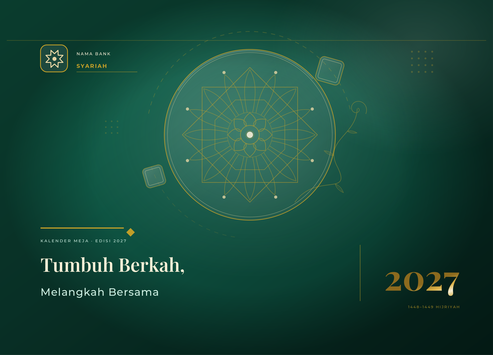
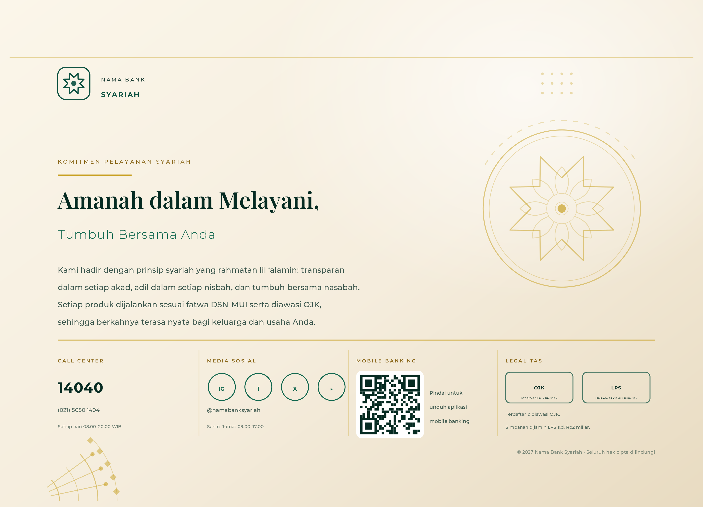

# Kalender Meja Korporat Bank Syariah — Konsep "Lensa Tumbuh"

Paket desain cover depan & belakang kalender meja korporat bank syariah,
gaya **playful elegant**, ukuran jadi **213 × 152 mm (landscape)** dengan
**zona jilid Wire-O 15 mm** di sisi atas.

> Tema: **"Tumbuh Berkah, Melangkah Bersama"** · Edisi 2027 (1448–1449 H)

## Pratinjau

| Cover depan | Cover belakang |
|---|---|
|  |  |

Pasangan cover satu lembar: `preview/00-pasangan-cover.png`
Panduan teknis (bleed/trim/safe area/lubang Wire-O/palet): `preview/03-panduan-teknis.png`

## Dokumen konsep

| Dokumen | Isi |
|---|---|
| [docs/01-konsep-visual.md](docs/01-konsep-visual.md) | Big idea, narasi motif, palet warna, tata letak detail cover depan & belakang (koordinat mm) |
| [docs/02-hirarki-tipografi.md](docs/02-hirarki-tipografi.md) | Pasangan typeface, type scale, tracking/leading, aturan hirarki & larangan |
| [docs/03-spesifikasi-teknis-cetak.md](docs/03-spesifikasi-teknis-cetak.md) | Dimensi, bleed, safe area, spesifikasi Wire-O, material, grid, file prep |
| [docs/04-finishing-produksi.md](docs/04-finishing-produksi.md) | Foil Gold, Spot UV, emboss, laminasi, urutan produksi, QC & toleransi |

## Struktur berkas

```
desain-kalender-syariah/
├── assets/      # SVG sumber (bisa dibuka di Illustrator/Inkscape, satuan mm)
│   ├── 01-cover-depan.svg
│   ├── 02-cover-belakang.svg
│   └── 03-panduan-teknis.svg
├── preview/     # PNG preview (±384 dpi) + PDF vektor siap inspeksi
├── src/         # generator artwork (Python, satuan milimeter)
│   ├── tokens.py       # palet, ukuran, copy
│   ├── svgkit.py       # helper SVG + konversi mm/pt
│   ├── patterns.py     # girih 8-fold, rosette, arabesque, QR dummy
│   ├── front_cover.py  # komposisi cover depan
│   ├── back_cover.py   # komposisi cover belakang
│   ├── spec_sheet.py   # lembar panduan teknis
│   └── build.py        # render SVG → PNG/PDF
└── docs/
```

## Membangun ulang artwork

```bash
python3 -m pip install cairosvg pillow      # dependensi render
python3 src/build.py                        # SVG + PNG + PDF + lembar pasangan
```

Font yang dipakai: **Playfair Display** (serif) dan **Montserrat** (sans) —
keduanya OFL, aman untuk komersial. Bila font belum terpasang, SVG tetap
terbuka benar di Illustrator/Inkscape selama font tersebut aktif di sistem.

## Asumsi yang wajib diganti sebelum produksi

1. **Logo & nama bank** — saat ini placeholder vektor (`NAMA BANK / SYARIAH`).
2. **Nomor call center, akun media sosial, nomor cabang** — contoh.
3. **QR code** — masih pola dummy (tidak bisa dipindai). Ganti dengan QR asli
   (ECC level M, minimal 20 × 20 mm) sebelum naik cetak.
4. **Logo OJK & LPS** — kotak legalitas masih tipografi placeholder. Wajib
   memakai berkas logo resmi (vektor, warna asli, tanpa diputarbalik/diubah)
   sesuai ketentuan OJK & LPS, beserta kalimat penjaminan yang berlaku.
5. **Tahun edisi** — 2027 (1448–1449 H) mengikuti siklus distribusi akhir 2026.

Konten teks lainnya (kalimat komitmen syariah) sudah disusun sebagai contoh;
silakan sesuaikan dengan *brand guideline* dan persetujuan legal/kepatuhan bank.
